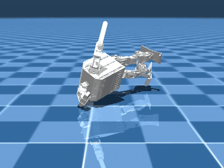

# Raíssa Paulo

Electrical Engineering student at the Federal University of Goiás (UFG), Brazil, researching **robotics, neuroscience and technology**. I work on fall recovery for humanoid robots with the [Pequi Mecânico](https://github.com/HumanoidPequi) team and study physiological signals in AR/VR.

  
   
  MARTA, our 20-DoF humanoid, getting up from a fall in MuJoCo with a reinforcement-learning policy (work in progress).

## Current work

### Fall recovery for the MARTA humanoid

[HumanoidPequi/frasa](https://github.com/HumanoidPequi/frasa) · reinforcement learning · MuJoCo · JAX

I'm adapting [FRASA](https://github.com/Rhoban/frasa) (Rhoban, University of Bordeaux), a reinforcement-learning agent for fall recovery, to MARTA, the Pequi Mecânico team's 20-DoF humanoid.

- On 200 test falls, the best policy so far brings the robot upright, sitting or kneeling, in 41% of them; a passive robot gets 0%.
- I fixed the simulation model and rebuilt parts of the training pipeline: 4× faster simulation per core, 2.7× higher training throughput and no NaNs in 20M training steps.
- Next: a critic that stays stable for longer (SAC/TQC), and demonstrations from the real robot's stand-up motion to close the gap from sitting to standing.

### Physiological signals in immersive environments

Undergraduate research (Iniciação Científica) on galvanic skin response (GSR) as a measure of relaxation under different sensory stimuli in AR/VR.

## Publication

Pereira Paulo, R. (2025). [*Moral Autonomy in Artificial Intelligence: Ethical and Technical Challenges*](https://www.incbac.org/authors-o-p/#PereiraPauloRaissa). UNIGOU Proceedings, INCBAC (Institute of Czech-Brazilian Academic Cooperation).

## Tools

ROS1 · ROS2 · MuJoCo · Python · C++ · JAX · Stable-Baselines3 / SBX · RL Zoo · Weights & Biases · Linux · Git

## Where my code is

Most of my work happens in organization repositories, mainly [HumanoidPequi](https://github.com/HumanoidPequi): the MARTA humanoid's control, simulation and FRASA.

## Contact

Open to internships and research positions in robotics, reinforcement learning and neurotechnology.

[LinkedIn](https://www.linkedin.com/in/raissa-paulo-4473a5253) · raissapaulowork@gmail.com
